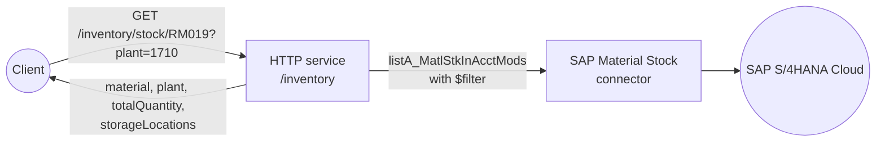

import ThemedImage from '@theme/ThemedImage';
import useBaseUrl from '@docusaurus/useBaseUrl';
import Tabs from '@theme/Tabs';
import TabItem from '@theme/TabItem';

# Expose SAP S/4HANA Stock Availability as a REST API

**Time:** About 30 minutes | **What you'll build:** An HTTP service with one `GET` resource that returns the live unrestricted-use stock of a material in a plant, read from SAP S/4HANA Cloud, with the total quantity and the quantity in each storage location.

Web shops, point-of-sale systems and warehouse apps all need the same answer before they promise anything to a customer: how much of this material is actually in stock? SAP S/4HANA knows, but its OData API speaks in SAP field names and returns quantities as text. In this guide you build a small REST API in front of it: a client calls `GET /inventory/stock/{material}?plant={plant}`, and the API asks SAP S/4HANA for that material's unrestricted-use stock in that plant and returns a clean JSON answer.

## How it works



Each request follows the same short flow:

1. Read the stock records for the material and plant from the Material Stock API, filtered to unrestricted-use stock (stock type `01`).
2. Turn each SAP record into a simple `{storageLocation, quantity, unit}` entry, converting the quantity from text to a number.
3. Add the quantities up into a total.
4. Return the material, plant, total and per-storage-location breakdown as JSON.

## Before you begin

:::info Prerequisites

- A working WSO2 Integrator environment. See [Setup](../../get-started/setup/setup.md).
- Access to an SAP S/4HANA Cloud system, and a communication user for the Material Stock API:
    - Follow the [SAP Material Stock connector setup guide](product://connectors/catalog/erp-business/sap.s4hana.api_material_stock_srv/setup-guide) to create a communication user, a communication system and a **Material Stock Integration** (`SAP_COM_0164`) communication arrangement.
    - It gives you the API hostname (for example, `my123456-api.s4hana.cloud.sap`) and the communication user's username and password, which you supply as configurables in Step 3.
- A material that has stock in your system, and the plant it is stored in. The examples in this guide use material `RM019` in plant `1710`.

:::

## Build the integration

Build the flow in the **Visual Designer**, or switch to the **Ballerina Code** tab to see the equivalent source the designer generates for you.

<Tabs>
<TabItem value="ui" label="Visual Designer" default>

## Step 1: Create the integration and the HTTP service

An [HTTP service](../../develop-and-test/integration-artifacts/integration-as-api/http.md#creating-an-http-service) exposes your integration as a REST API, which is what the calling applications need.

1. Create a new integration named `StockAvailability` in a project named `StockAvailability`.

    <ThemedImage
        alt="Create Integration dialog with the integration name and project name both set to StockAvailability"
        sources={{
            light: useBaseUrl('/img/guides/usecases/sap-s4hana-stock-availability-api/01-create-integration.png'),
            dark: useBaseUrl('/img/guides/usecases/sap-s4hana-stock-availability-api/01-create-integration.png'),
        }}
    />

2. On the **Artifacts** page, select **HTTP Service** under **Integration as API**.

    <ThemedImage
        alt="Artifacts page with the HTTP Service card selected under Integration as API"
        sources={{
            light: useBaseUrl('/img/guides/usecases/sap-s4hana-stock-availability-api/02-add-http-service.png'),
            dark: useBaseUrl('/img/guides/usecases/sap-s4hana-stock-availability-api/02-add-http-service.png'),
        }}
    />

3. Keep **Design From Scratch**, set **Service Base Path** to `/inventory`, and select **Create**.

    <ThemedImage
        alt="Create HTTP Service form with Design From Scratch selected and the service base path set to /inventory"
        sources={{
            light: useBaseUrl('/img/guides/usecases/sap-s4hana-stock-availability-api/03-create-http-service.png'),
            dark: useBaseUrl('/img/guides/usecases/sap-s4hana-stock-availability-api/03-create-http-service.png'),
        }}
    />

## Step 2: Add the stock resource

1. Select **Add Resource**, then **GET**.
2. Set **Resource Path** to `stock/[string material]`. The part in square brackets is a [path parameter](../../develop-and-test/integration-artifacts/integration-as-api/http.md#path-parameters), so the material number arrives as the `material` variable.
3. Select **Query Parameter**, enter `plant` as the name, and select **Save**. A [query parameter](../../develop-and-test/integration-artifacts/integration-as-api/http.md#query-parameters) of type `string` is required by default, so a request without `?plant=` is rejected with `400 Bad Request`.
4. Keep the default responses (`200` with `json`, `500` with `error`) and select **Save**.

    <ThemedImage
        alt="New Resource Configuration panel with the GET method, the resource path stock/[string material], a string query parameter named plant, and 200 json and 500 error responses"
        sources={{
            light: useBaseUrl('/img/guides/usecases/sap-s4hana-stock-availability-api/04-add-get-resource.png'),
            dark: useBaseUrl('/img/guides/usecases/sap-s4hana-stock-availability-api/04-add-get-resource.png'),
        }}
    />

The resource opens in the flow designer, with **Start**, an empty step and the **Error Handler**.

## Step 3: Connect to SAP S/4HANA

1. Select the **+** below **Start**, then [**Add Connection**](../../develop-and-test/integration-artifacts/supportive-artifacts/connections.md#adding-a-connection). Search for `api_material_stock` and select the **Api_material_stock_srv** connector.

    <ThemedImage
        alt="Add Connection dialog searching for api_material_stock, with the Api_material_stock_srv connector card shown under Pre-built Connectors"
        sources={{
            light: useBaseUrl('/img/guides/usecases/sap-s4hana-stock-availability-api/05-search-material-stock-connector.png'),
            dark: useBaseUrl('/img/guides/usecases/sap-s4hana-stock-availability-api/05-search-material-stock-connector.png'),
        }}
    />

2. Create three `string` configurables so the credentials are supplied at runtime instead of stored in the flow: in a field's [Expression editor](../../editor/panels/expression-panel.md) helper pane, select **Configurables**, then **New Configurable**. Name them `sapS4HanaHostname`, `sapS4HanaUsername` and `sapS4HanaPassword`.
3. Bind **Hostname** to `sapS4HanaHostname`.
4. Switch **Config** to **Expression** and enter:

    ```ballerina
    {auth: {username: sapS4HanaUsername, password: sapS4HanaPassword}}
    ```

    The connector uses Basic Authentication with the communication user from the setup guide.

5. Keep the connection name `apiMaterialStockSrvClient` and select **Save Connection**.

    <ThemedImage
        alt="Configure Api_material_stock_srv dialog with Config set to an auth expression using sapS4HanaUsername and sapS4HanaPassword, and Hostname bound to sapS4HanaHostname"
        sources={{
            light: useBaseUrl('/img/guides/usecases/sap-s4hana-stock-availability-api/06-material-stock-connection.png'),
            dark: useBaseUrl('/img/guides/usecases/sap-s4hana-stock-availability-api/06-material-stock-connection.png'),
        }}
    />

## Step 4: Read the stock records

The Material Stock API exposes stock "in the account model": one record per combination of material, plant, storage location, batch, stock type and special stock. You read the records for one material and plant and keep only unrestricted-use stock.

1. In the node panel, expand **apiMaterialStockSrvClient** under **Connections** and select **List A Matl Stk In Acct Mods** (`listA_MatlStkInAcctMods`).

    <ThemedImage
        alt="Node panel with the apiMaterialStockSrvClient connection expanded, listing its operations including List A Matl Stk In Acct Mods"
        sources={{
            light: useBaseUrl('/img/guides/usecases/sap-s4hana-stock-availability-api/07-material-stock-operations.png'),
            dark: useBaseUrl('/img/guides/usecases/sap-s4hana-stock-availability-api/07-material-stock-operations.png'),
        }}
    />

2. Expand **Advanced Configurations**, switch **$Filter** to **Expression**, and enter this string template. It inserts the `material` path parameter and the `plant` query parameter into an OData filter:

    ```ballerina
    string `Material eq '${material}' and Plant eq '${plant}' and InventoryStockType eq '01'`
    ```

    `InventoryStockType eq '01'` keeps only unrestricted-use stock, the stock you can actually sell or issue. Drop that condition if you also want quality-inspection or blocked stock.

3. Set **Result** to `stockRecords` and select **Save**.

    <ThemedImage
        alt="listA_MatlStkInAcctMods operation form with the $Filter expression built from the material and plant variables"
        sources={{
            light: useBaseUrl('/img/guides/usecases/sap-s4hana-stock-availability-api/08-configure-list-stock-filter.png'),
            dark: useBaseUrl('/img/guides/usecases/sap-s4hana-stock-availability-api/08-configure-list-stock-filter.png'),
        }}
    />

## Step 5: Shape the response

SAP returns the records inside an OData envelope (`d.results`) and the quantity, `MatlWrhsStkQtyInMatlBaseUnit`, as text. Two [Declare Variable](../../editor/canvases/flow-canvas/node-palette.md#declare-variable) steps turn that into the response.

1. Select the **+** after the operation, then **Declare Variable**. Name it `storageLocations`, set **Type** to `json[]`, and enter this expression. It builds one entry per storage location and converts the quantity to a `decimal`:

    ```ballerina
    from var s in stockRecords.d?.results ?: [] select {storageLocation: s?.StorageLocation, quantity: check decimal:fromString(s?.MatlWrhsStkQtyInMatlBaseUnit ?: "0"), unit: s?.MaterialBaseUnit}
    ```

    <ThemedImage
        alt="Declare Variable form for storageLocations of type json[] with a query expression over stockRecords.d?.results"
        sources={{
            light: useBaseUrl('/img/guides/usecases/sap-s4hana-stock-availability-api/09-declare-storage-locations.png'),
            dark: useBaseUrl('/img/guides/usecases/sap-s4hana-stock-availability-api/09-declare-storage-locations.png'),
        }}
    />

2. Add another **Declare Variable** after it. Name it `totalQuantity`, set **Type** to `decimal`, and enter:

    ```ballerina
    decimal:sum(...from var s in stockRecords.d?.results ?: [] select check decimal:fromString(s?.MatlWrhsStkQtyInMatlBaseUnit ?: "0"))
    ```

    The designer shows this step as **decimal : sum** on the canvas, because its value comes from a function call.

    <ThemedImage
        alt="Declare Variable form for totalQuantity of type decimal with a decimal:sum expression"
        sources={{
            light: useBaseUrl('/img/guides/usecases/sap-s4hana-stock-availability-api/10-declare-total-quantity.png'),
            dark: useBaseUrl('/img/guides/usecases/sap-s4hana-stock-availability-api/10-declare-total-quantity.png'),
        }}
    />

## Step 6: Return the result

1. Add a [**Return**](../../editor/canvases/flow-canvas/node-palette.md#return) step after `totalQuantity` and enter:

    ```ballerina
    {material: material, plant: plant, totalQuantity: totalQuantity, storageLocations: storageLocations}
    ```

    <ThemedImage
        alt="Return form with a record expression containing material, plant, totalQuantity and storageLocations"
        sources={{
            light: useBaseUrl('/img/guides/usecases/sap-s4hana-stock-availability-api/11-return-stock-response.png'),
            dark: useBaseUrl('/img/guides/usecases/sap-s4hana-stock-availability-api/11-return-stock-response.png'),
        }}
    />

2. Select **Save**. The completed flow reads the stock, builds the breakdown, totals it and returns it.

    <ThemedImage
        alt="Completed resource flow: Start, the listA_MatlStkInAcctMods call to apiMaterialStockSrvClient, the storageLocations declaration, decimal : sum for totalQuantity, Return, and the Error Handler"
        sources={{
            light: useBaseUrl('/img/guides/usecases/sap-s4hana-stock-availability-api/12-completed-flow.png'),
            dark: useBaseUrl('/img/guides/usecases/sap-s4hana-stock-availability-api/12-completed-flow.png'),
        }}
    />

If the SAP call fails (for example, wrong credentials or a missing communication arrangement), the **Error Handler** returns the error, and the client receives `500 Internal Server Error`.

</TabItem>
<TabItem value="code" label="Ballerina Code">

```ballerina
// config.bal
configurable string sapS4HanaHostname = ?;
configurable string sapS4HanaUsername = ?;
configurable string sapS4HanaPassword = ?;
```

```ballerina
// connections.bal
import ballerinax/sap.s4hana.api_material_stock_srv;

final api_material_stock_srv:Client apiMaterialStockSrvClient = check new ({auth: {username: sapS4HanaUsername, password: sapS4HanaPassword}}, string `${sapS4HanaHostname}`);
```

```ballerina
// main.bal
import ballerina/http;
import ballerinax/sap.s4hana.api_material_stock_srv;

listener http:Listener httpDefaultListener = http:getDefaultListener();

service /inventory on httpDefaultListener {
    resource function get stock/[string material](@http:Query string plant) returns json|error {
        do {
            api_material_stock_srv:CollectionOfA_MatlStkInAcctModWrapper stockRecords = check apiMaterialStockSrvClient->listA_MatlStkInAcctMods(\$filter = string `Material eq '${material}' and Plant eq '${plant}' and InventoryStockType eq '01'`);
            json[] storageLocations = from var s in stockRecords.d?.results ?: []
                select {storageLocation: s?.StorageLocation, quantity: check decimal:fromString(s?.MatlWrhsStkQtyInMatlBaseUnit ?: "0"), unit: s?.MaterialBaseUnit};
            decimal totalQuantity = decimal:sum(...from var s in stockRecords.d?.results ?: []
                        select check decimal:fromString(s?.MatlWrhsStkQtyInMatlBaseUnit ?: "0"));
            return {material: material, plant: plant, totalQuantity: totalQuantity, storageLocations: storageLocations};
        } on fail error err {
            // handle error
            return error("unhandled error", err);
        }
    }

}
```

</TabItem>
</Tabs>

## Run and verify

1. Open **Configurations** and supply values for `sapS4HanaHostname`, `sapS4HanaUsername` and `sapS4HanaPassword`, or add them to `Config.toml` with **Edit Config.toml**. See [Configurations](../../develop-and-test/integration-artifacts/supportive-artifacts/configurations.md#providing-values). Keep `Config.toml` out of source control.

    <ThemedImage
        alt="Configurable Variables page listing sapS4HanaHostname, sapS4HanaUsername and sapS4HanaPassword as required string values"
        sources={{
            light: useBaseUrl('/img/guides/usecases/sap-s4hana-stock-availability-api/13-configurable-variables.png'),
            dark: useBaseUrl('/img/guides/usecases/sap-s4hana-stock-availability-api/13-configurable-variables.png'),
        }}
    />

2. Select **Run**. The service starts on port `9090`.
3. On the resource, select **Try It**, then **Try It (Try resource with Hurl Client)**. Replace the placeholders so the request reads as follows, and run the cell:

    ```text
    GET http://localhost:9090/inventory/stock/RM019

    [QueryStringParams]
    plant: 1710
    ```

    You can also call the API with any HTTP client, for example `curl "http://localhost:9090/inventory/stock/RM019?plant=1710"`.

4. The response lists the unrestricted-use stock of the material in each storage location of the plant, and the total:

    <ThemedImage
        alt="Hurl Try It notebook showing the GET request for RM019 in plant 1710 and a 200 OK response with totalQuantity 38 and three storage locations, 171A, 171B and 171C"
        sources={{
            light: useBaseUrl('/img/guides/usecases/sap-s4hana-stock-availability-api/14-try-it-response.png'),
            dark: useBaseUrl('/img/guides/usecases/sap-s4hana-stock-availability-api/14-try-it-response.png'),
        }}
    />

    ```json
    {
      "material": "RM019",
      "plant": "1710",
      "totalQuantity": 38.000,
      "storageLocations": [
        {"storageLocation": "171A", "quantity": 20.000, "unit": "KG"},
        {"storageLocation": "171B", "quantity": 10.000, "unit": "KG"},
        {"storageLocation": "171C", "quantity": 8.000, "unit": "KG"}
      ]
    }
    ```

    A material with no unrestricted-use stock in the plant returns `"totalQuantity": 0` and an empty `storageLocations` list.

The integration overview now shows the whole API: the HTTP listener, the `/inventory` service with its `GET` resource, and the SAP S/4HANA connection it uses.

<ThemedImage
    alt="StockAvailability integration overview showing httpDefaultListener connected to the /inventory HTTP service with its GET /stock/[string material] resource, which uses the apiMaterialStockSrvClient connection"
    sources={{
        light: useBaseUrl('/img/guides/usecases/sap-s4hana-stock-availability-api/15-integration-overview.png'),
        dark: useBaseUrl('/img/guides/usecases/sap-s4hana-stock-availability-api/15-integration-overview.png'),
    }}
/>

## What's next

Now that the API works, you can take it further:

- **Deploy it.** Ship it to [WSO2 Cloud](../../deploy-and-run/deploy-to-wso2-cloud/deploy-to-wso2-cloud.md), a [Docker container](../../deploy-and-run/self-hosted/containerized-deployment.md#docker-deployment), [Kubernetes](../../deploy-and-run/self-hosted/containerized-deployment.md#kubernetes-deployment), or a [virtual machine](../../deploy-and-run/self-hosted/vm-deployment.md), and put it behind your API gateway.
- **Check several materials at once.** Add a `POST /inventory/stock` resource that takes a list of materials and builds an OData filter such as `(Material eq 'RM019' or Material eq 'FG011') and Plant eq '1710'`, so a shopping cart needs a single call.
- **Reserve the stock.** Once availability is confirmed, create a reservation with the [SAP Reservation Document connector](product://connectors/catalog/erp-business/sap.s4hana.api_reservation_document_srv/sap-reservation-document-connector-overview) so the quantity is held for the order.
- **Explore the other operations.** The [Material Stock action reference](product://connectors/catalog/erp-business/sap.s4hana.api_material_stock_srv/actions) covers every operation, including reading serial numbers for serialized materials.
